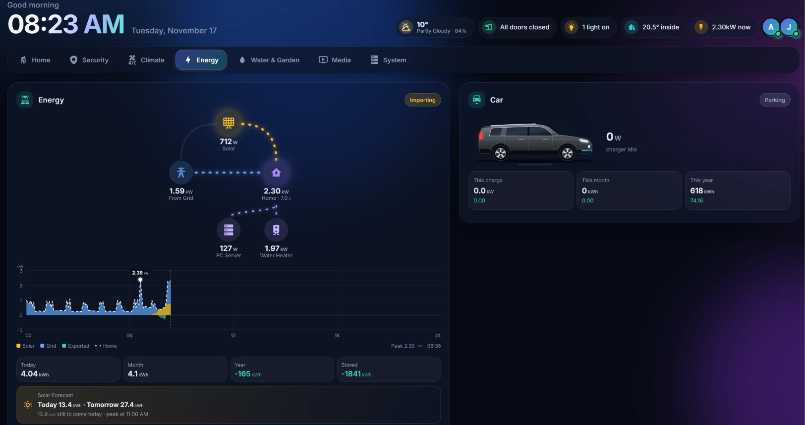
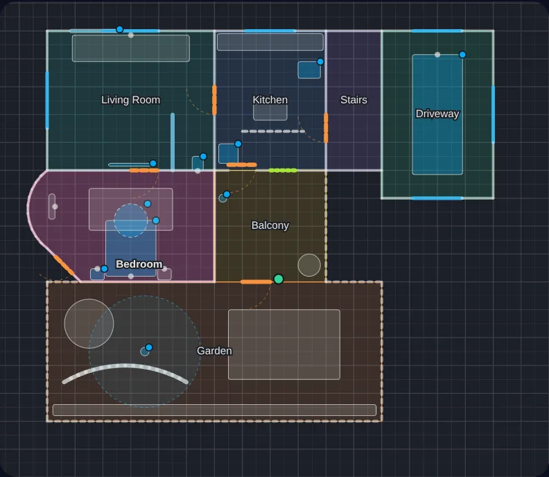

# Sweet Home

[](https://my.home-assistant.io/redirect/hacs_repository/?owner=mousawm&repository=sweet-home&category=plugin)


Your home as an interactive **3D model** in Home Assistant. Tap a room to see and switch what is in it. Tabs cover
security, climate, energy, water, media and your home lab.

- **3D house**: walls, windows, doors that swing open with their contact sensors, furniture, glowing lights (ceiling
  lights, spots, LED strips, TV backlight), AC airflow, motion pulses and lock badges. Three views: Lights, Climate and Presence.
- **Works with no setup**: without any configuration it builds a simple house from your Home Assistant areas. Draw
  your real floor plan in the card editor, or load your own `.glb` model.
- **Panels**, each shown only when Home Assistant has something for it:
  - **Security**: alarm with a PIN keypad, locks, doors, live cameras
  - **Climate**: ACs, temperatures
  - **Energy**: live power flow and a chart of today, plus history by day, week, month and year from your Energy settings
  - **Water & Irrigation**: tank trend, pumps, valves, schedule
  - **Media**: TV and speakers, plus a Jellyfin / Sonarr / Radarr / qBittorrent media server card
  - **Home Lab**: Proxmox VE node and guests
  - **Needs Attention**: unavailable devices, low batteries, weak Wi-Fi, repairs, updates
- **Made for phones**:
  - Swipe between tabs. Haptics. Long press opens more-info; double tap opens the second entity.
  - Popups don't scroll the page behind them. Skeleton loaders while data arrives.
  - The 3D view sleeps when nothing moves, to save battery.

## Screenshots

| Security | Climate |
|---|---|
|  |  |
| **Energy** | **Water & Garden** |
|  |  |
| **3D house** | **Furniture that reacts** |
|  |  |
| **Floor plan editor** | **On a phone** |
|  |  |

## Install

### Marketplace (recommended)

Home Assistant's **Marketplace** (formerly HACS):

[](https://my.home-assistant.io/redirect/hacs_repository/?owner=mousawm&repository=sweet-home&category=plugin)

1. Click the button above. It opens Sweet Home in your Marketplace and offers to add the repository. Or add it by hand: **Marketplace** → ⋮ → **Custom repositories**, this repository's URL, type **Dashboard**.
2. Search the Marketplace for **Sweet Home** and download it.
3. Reload the browser, then [add the dashboard](#from-add-dashboard-recommended).

The Marketplace adds the dashboard resource for you. If it doesn't, add `/local/community/sweet-home/sweet-home-card.js`
as a **JavaScript module** under Settings → Dashboards → ⋮ → Resources.

### Manual

Download `sweet-home-card.js` from the latest release and put it in `/config/www/`. Then add
`/local/sweet-home-card.js` as a JavaScript module resource.

## Add it to Home Assistant

### From "Add dashboard" (recommended)

Once Sweet Home is installed, it is listed with the other community dashboards:

1. Go to **Settings → Dashboards → Add dashboard**.
2. Under **Community dashboards**, pick **Sweet Home**. Its description reads *"Your home as an interactive 3D model, with
   tabs for security, climate, energy, media and more. Built from your areas."*
3. Give the dashboard a name and an icon, then open it from the sidebar.

The dashboard builds itself from your Home Assistant **areas**. Each area becomes a room with its lights, sensors, doors
and climate devices. The tabs show what Home Assistant has for them: alarm, locks, cameras, energy, media and so on.
It shows the whole house full screen.

Not listed? Reload the browser after installing (on the phone app: ⋮ → Reload resources), and check that you have
version 0.1.1 or newer.

### Edit it

The dashboard is generated for you until you take control of it:

1. Open the dashboard and click the **pencil** (or **⋮ → Edit dashboard**) at the top right.
2. Choose **Take control**. The dashboard becomes a normal one with a single Sweet Home card.
3. Click **Edit** at the left end of the bar under the card. The ⋮ at its right end only has move, copy and delete.
4. The Sweet Home editor opens with three steps:
   1. **Rooms**: a floor plan with four modes. A setup guide walks you through them the first time.
      **Room by room** (in the setup guide, or **+ Room by room** above the plan) goes through your Home Assistant
      areas one at a time. For each, pick a shape (rectangle, L, T, U, cut corner, bay, curved, round), a size (a
      starting size comes from the room's name) and where it goes (right of / below / left of / above a room already
      on the map; a dashed preview shows the spot). **Add to the map** or **Skip**; **Add a room that isn't an area**
      for anything else; **Finish** whenever you like.
      - **Shape**: add rooms (or all your areas at once), link them to areas, and draw them by dragging on a grid. Drag
        a rectangle to move it and its corner dots to resize it. Draw more than one rectangle for an L-shaped room.
        Duplicate or delete rooms.
        - **Ready-made shapes**: rectangle, L, T, U, cut corner, bay window, curved wall and round. Tap one to give the
          room that shape in the space it takes now. **Turn** and **Mirror** change which way it faces.
        - **Edit corners** gives a room free corners. Drag a corner to move it, which slants the walls next to it. Drag
          the square in the middle of a wall to bend it into a curve, or tap the square to add a corner there.
        - **Draw walls**: tap each corner of the room in turn and its walls follow; tap the first corner again (or
          **Done**) to close it. **Straight walls** keeps every wall at a multiple of 45°; turn it off to draw at any angle.
          **Remove last corner** (or Backspace) steps back.
        - **Rotate**: **Turn** (a quarter), **15°** either way, or type any angle. A room drawn with rectangles gets free
          corners first. In the room-by-room guide, **Turn** turns the ready-made shape before it is added.
        - **Separate walls**: drag on the plan to draw a wall that stands on its own, in any direction. Use it for a
          partition, a kitchen half wall, a glass screen or a curved garden wall. Tap one to set its kind, height and
          bend, or drag it to move it. Doors and openings cut separate walls too.
      - **Entities**: what each room shows in its popup. Devices in the room's area are found on their own. Remove
        what you don't want, add other devices from the area, or add any entity. Edit a name to rename the entity on this
        dashboard (Home Assistant is not changed). Set how each light is drawn (ceiling
        light, spots, LED strip, TV backlight), with or without colours. For an LED strip, pick the walls it runs along and
        whether it stops where a wall is missing. A list shows devices that are in no room yet.
      - **Furniture**: pick a piece, then tap the plan to place it. Drag to move, use the corner dot to resize, and
        **Turn** to rotate. Link a piece to one or more entities, such as a lamp to its light or a bed to the bedside
        lights, so it can be tapped in the 3D view. **Suggest furniture** fills a room from its name.
        Two sofas (or two counters) placed at a right angle with their ends overlapping become one L-shaped corner sofa
        (or corner counter; worktops at the same height join too). Pieces made of several parts have a colour for each:
        a sofa's frame and back, seat cushions and pillows; a bed's duvet, frame, headboard and pillows; a table's top and
        legs; a chair's frame and seat. A piece moved or placed within 35 cm of a wall goes flat against it. Resizing
        changes only the side you drag; the other keeps its exact size.
      - **Doors & windows**: rooms are closed by walls until you add a way through. Drag along a wall to add a door
        (pick its contact sensor to make it swing open in 3D), a window or an open passage. Tap to add a lock badge.
        Drag any of them to move it. On a slanted wall the door follows the wall; on a curved wall a door or passage runs from point to point of the curve. They work on every wall: inner and outer walls, outdoor railings, and separate walls.

      **Floors**: tabs above the plan switch floors, and **Add floor** adds one. Other floors show as dashed outlines
      so you can line them up. Areas on a Home Assistant floor are added to that floor.

      **Undo / Redo** (Ctrl+Z / Ctrl+Shift+Z) cover every change. *Things to check* lists entities that weren't found,
      rooms without a shape and devices that are in another room's area.
   2. **Panels**: turn panels on or off and pick their entities. **Modes** adds one-tap buttons to the Home tab (guests, holiday, scenes, scripts).
   3. **Look**: title, weather, start tab, wall height, automatic furniture, **Hide the "tap a room" tip** (on: the tip and the "tap a room" under the 3D view's title are not shown), or a 3D file.
      **Names on this dashboard** lists every entity renamed here (in a room or on a panel). Change or clear a name,
      or rename any other entity.
5. Click **Save**, then **Done**.

Everything the editor doesn't cover can be added in YAML (**Show code editor**, or the dashboard's **⋮ → Raw
configuration editor**), and the editor keeps it. See [Configuration](#configuration) below.

### As a card on any dashboard

You can also add the card yourself: **Edit dashboard → Add card → Sweet Home**, or in YAML:

```yaml
type: custom:sweet-home-card
```

It is built to fill the screen, so put it in a view with the **Panel** layout (view settings → View type → Panel).

## Configuration

| Option | Description |
|---|---|
| `title` | Name in the 3D view header (default `My Home`) |
| `weather` | Weather entity for the header chip and weather sheet (default: the first one) |
| `persons` | Person entities shown as avatars. Long press opens the phone panel when the person has a Companion app tracker. |
| `people` | Each person's phone panel (long press their picture): `{person.x: {name, tracker, battery, charging, location, ringer, wifi, entities, buttons}}`. With none of `tracker`, `battery`, `charging`, `location`, `ringer`, `wifi` given they are all found on the person's phone (Companion app); once you give one, only the ones you give show; `entities` adds rows, `buttons` adds buttons (ring the phone, scripts…): `entity_id` or `{entity, name, icon}`. Without a name, a button shows its own name without "button" and the phone's name; without an icon, one is picked from what it does (ring → bell, location → target, flashlight, lock…). While the dashboard is edited, the pencil on the phone panel renames its rows and buttons for this dashboard. Set it up in the card editor: Panels → People. |
| `start_tab` | `home` / `security` / `climate` / `energy` / `water` / `media` / `system` |
| `names` | Names for this dashboard only, for any entity: `{sensor.ev_power: Car charging}`. They replace the entity's name on every panel of the card (Home Assistant is not changed). Room names (`names` inside a room) work the same way. |
| `modes` | Mode buttons on the Home tab, under At a glance (`entity_id` or `{entity, name, icon}`): switches, helpers, lights and automations light up while on; scenes, scripts and buttons run with one tap. Pick them in the card editor: Panels → Modes. |
| `devices` | Phones and tablets with battery and charging state (default: every Companion app battery sensor) |
| `hint` | `false` hides the "tap a room" tip shown on first use |
| `language` | Language of the card, such as `ar` (default: your Home Assistant language). Arabic is translated and laid out right to left; other languages fall back to English. |
| `house` | The 3D model, described below |
| `panels` | The panels, described below. `panels.<name>: false` hides one. |

### `house`

| Option | Description |
|---|---|
| `rooms` | List of rooms, described below. Leave it out to build the house from your areas (one floor per Home Assistant floor). |
| `levels` | Floor names: `[{level: 0, name: Downstairs}, {level: 1, name: Upstairs}]` (default: the Home Assistant floor names) |
| `doorways` | `auto` puts a doorway in every wall between two rooms. By default walls stay closed until you add `doors` or `openings`. (The house built from your areas always gets doorways.) |
| `areas` | With automatic rooms: only these area ids |
| `auto_furniture` | Add furniture to every room based on its name |
| `wall_height` | In metres (default 1.35, a cut-away dollhouse height) |
| `walls` | Your own wall segments `[x1, z1, x2, z2, type]`, where type is `w` (wall), `win` (window) or `rail` (glass railing). By default, walls are drawn around the rooms. |
| `extra_walls` | Walls that stand on their own, on top of the room walls: `from: [x, z]`, `to: [x, z]`, `type` (`wall`, `half` or `glass`), `height` (m), `bow` (bends the wall into an arc: how many metres its middle moves to one side, negative for the other side), `level`. A plain `[x1, z1, x2, z2]` works too. Doors and openings cut them. |
| `openings` | Gaps in the automatic walls `[x1, z1, x2, z2]`, plus the floor as a 5th item when it isn't the ground floor |
| `windows` | Window segments on the automatic outer walls (`[x1, z1, x2, z2, level]`) |
| `doors` | Doors: `from: [x, z]`, `to: [x, z]`, `entity` (contact sensor: the door swings open while it is open; without one the door stays shut), `side` (1 / −1: which way it swings), `main`, `level`. A door cuts its own gap in the wall; one placed up to 0.4 m off a wall is moved onto it. |
| `door_info` | Names and timeout sensors for doors in the room popup (`entity`, `name`, `timeout`) |
| `lock_badges` | Small 3D badges for locks: `lock`, `x`, `z`, `y`, `axis`, `level`, `name` (shown above the badge; default the lock's name), `label: false` (no name). Tap the name for the lock's details; while the dashboard is edited, its pencil renames the badge (this dashboard only). |
| `furniture` | Furniture anywhere in the house (the same pieces as in rooms) |
| `type: gltf`, `url`, `scale`, `rotation`, `offset`, `mesh_rooms` | Use your own 3D file instead of the drawn walls. See [examples/gltf.yaml](examples/gltf.yaml). |

Coordinates are in metres. **x** runs to the east (right) and **z** to the south (down the screen). The plan is
shifted so that it starts at 0.

### Rooms

```yaml
- area: bedroom               # devices in this area are found automatically
  name: Main Bedroom          # default: the area name
  rects: [[0, 5, 5, 9]]       # one or more [x1, z1, x2, z2] (two that touch make an L, with no wall between them)
  # or an outline, for slanted and curved walls: the corners in order. A third number bends the wall that starts
  # at that corner into an arc (metres its middle bows out of the room; negative: into the room).
  # points: [[0, 5], [5, 5], [5, 9], [1.2, 9], [0, 7.8, 0.7]]   # a cut corner and a curved wall
  # points: [[0, 7, 2], [4, 7, 2]]                              # two bent corners make a round room
  icon: mdi:bed
  floor: carpet               # wood, tile, marble, carpet, stone, grass, asphalt (parking)
  outdoor: false
  level: 1                    # the floor (default 0, the ground floor)
  stairs: true                # a flight of stairs, set by the floors: up from the lowest floor, down from the top
                              # one, both ways in between (one up, one down into a stairwell). Or: both, up, down;
                              # false: none. Rooms named "Stairs" get them on their own. With one floor (a flat in a
                              # building) they go both ways. The flight going down shows only through its hole in the
                              # floor, so nothing hangs below the house.
  furniture: [...]            # or `false` for none
  # overrides for what was discovered:
  lights: [light.bedroom]
  temperature: sensor.bedroom_temperature
  humidity: sensor.bedroom_humidity
  motion: [binary_sensor.bedroom_motion]
  climate: climate.bedroom_ac
  media: media_player.bedroom_tv
  plugs: [switch.bedside_plug]
  entities: [cover.bedroom_blinds, script.good_night]   # anything else, under "Other"
                                         # (default: blinds, plain switches, valves… found in the area)
  light_fx: {light.bedroom_led: strip}   # center, spots, strip or tv
  light_names: {light.bedroom_led: LED Strip}
  names: {script.good_night: Bedtime}    # names for this card only: they replace the entity's name everywhere on
                                         # the dashboard (renaming in the card editor or the popup writes these)
  color_lights: [light.bedroom_led]      # show colour swatches
  simple_lights: [light.tv_backlight]    # on/off only
  strip_sides: nes                       # walls that have the LED strip (an outline room: all of its walls)
  strip_mode: walls                      # stop the strip where a wall is missing (doors, openings); default: full side
  ac: {x: 0.2, z: 6, dx: 1, dz: 0}       # where the AC unit hangs and which way it blows
  anchor: [2.5, 7]                       # label position
```

### Furniture

Each piece has a `type` plus a position. `x`, `z` give the centre; `from` and `to` give the corners. Colours are `#hex`.

Any piece can be linked to entities with `entity` (or `entities` for several), plus an optional `name`. A linked
piece can be tapped in the 3D view: its room opens with the piece and its entities at the top. It also gets a small
badge, which shows the entity's icon while it is on or while its room is open. `badge: false` hides the badge.

```yaml
furniture:
  - { type: bed, x: 3, z: 7.8, head: s, entities: [light.bedside_left, light.bedside_right] }
  - { type: lamp, x: 1.6, z: 8.5, entity: light.reading_lamp }
  - { type: fan, x: 3, z: 6.8, entity: fan.bedroom }
  - { type: marker, name: Window sensor, x: 0.3, z: 6, entity: binary_sensor.bedroom_window }
  - { type: box, name: Coffee corner, x: 9.4, z: 1.4, w: 0.8, d: 0.6, h: 0.9, entity: switch.coffee_machine }
```

| type | Options |
|---|---|
| `box` | `x z w d h y color roughness metalness opacity emissive` |
| `block` | `from to h y color` |
| `rug` | `x z w d color` |
| `table` | `x z w d h top leg` |
| `chair` | `x z face (n/s/e/w) color seat` |
| `sofa` | `from to back (n/s/e/w) color cushion pillow arms (both/start/end/none)` |
| `bed` | `x z width length head (n/s/e/w) frame duvet headboard pillow house_headboard` |
| `nightstand` | `x z w d h facing (n/s/e/w: where the drawers look) drawers (1-4) lamp (false hides it) color top handle shade entity plug power charging_w`: a bedside table with a table lamp that glows with its light. With `plug` (a phone charger's smart plug), a phone lies on top while it charges: while the plug draws more than `charging_w` (1.5 W) on `power`. `power` is found from the plug's own device when left out; with no power sensor, plug on means charging. Automatic bedrooms get one each side of the bed. |
| `plant` | `x z size` |
| `cylinder`, `ball` | `x z radius h y color` |
| `tv` | `x z w h y facing entity`: the screen flickers while the player plays |
| `charger` | `x z y plug power charging_w color phone_color`: a charging pad; the phone on it shows (and glows) only while it charges, as for `nightstand` |
| `stairs` | `from to axis (x/z) mode (up/down/split) steps motion` |
| `lamp` | `x z h size color shade entity`: the shade glows in the light's colour and brightness |
| `fan` | `x z y radius color blade entity`: a ceiling fan whose blades turn at the fan's speed |
| `marker` | `x z y color entity`: a device with no furniture (a sensor, a plug): a dot that lights up while it is on |
| `blinds` | `from to y h color shade entity`: a blind along a window that rolls down with the cover's position |
| `vacuum` | `x z color entity`: a dock and a robot that drives around the room while it cleans and goes back after |
| `car` | `x z facing (n/e/s/w: where its front points) color length width entity parked_state`: a car in a painted bay. With a sensor it is there only while it is parked, and drives in / off when that changes: a binary sensor that is on, a tracker or person at `home`, or a state like `parked` (`parked_state` sets the exact state). |
| `ac` | `x z style (wall/cassette/floor) facing (n/e/s/w: where it blows) color y entity`: an AC unit that glows and blows air in its mode's colour while its climate entity runs. With no entity it uses its room's. A room with an `ac` piece has no automatic unit; in the editor a wall unit turns to blow away from the wall it is put against. |
| `toilet` | `x z w d facing color seat` |
| `sink` | `x z w d h facing color top entity`: a vanity with a basin, tap and mirror; the mirror glows while its light is on |
| `shower` | `x z w d facing entity`: a tray with glass; steam rises while a switch / water heater is on, or a humidity sensor is above 70 % |
| `bathtub` | `x z w d facing water (false: empty)` |
| `washer` | `x z w d h facing entity`: a front-loader whose drum turns while it runs (a power sensor above 5 W, or a running / on state) |
| `towel` | `x z w y facing color entity`: a towel warmer whose rails glow warm while it is on |
| `tree` | `x z size color trunk` |
| `hedge` | `from to h color` |
| `pool` | `from to color` |
| `sprinkler` | `x z radius entity`: sprays water in 3D while its valve or switch is on |
| all types | `entity` / `entities`, `name`, `badge` |

**Icons.** Switches, fans, plugs, modes, scripts and phone buttons get an icon that suits their name (a fan, a water heater,
a guest mode…), in English or Arabic; a fan's icon turns while it is on. `smart_icons: false` (Look → *Automatic icons*
off) uses the icons set in Home Assistant instead. An icon you set in the card always wins.

`facing` is the side a piece's front looks to; `w` and `d` are its size along x and z. In the editor, a toilet, sink, washer…
placed near a wall sits flat against it and turns to face into the room. Automatic bathrooms get a toilet, a sink and a
bathtub (or a shower when the room is small); laundries get a washing machine.

**Move furniture in 3D**: while the dashboard is in edit mode, admins get a **move** button on the 3D view. Turn it on and drag pieces across the floor.
While the card editor is open, each move goes through it (with undo). Otherwise it is saved straight into the
dashboard. Pieces from the automatic set can be moved once their room has its own furniture (card editor → Furniture).

### Parking and garden

- **Parking**: a room named Garage, Parking, Carport or Driveway gets an asphalt floor (or pick *Parking (asphalt)*
  as its floor). Add a **Car** in the card editor (Furniture), pick its colour, and link the sensor that says the car
  is home: an occupancy or presence binary sensor from a camera, a `device_tracker` of the car, or a template sensor.
- **Garden**: draw a room for it, tick *Outdoor* and pick the *Grass* floor (rooms named Garden or Yard do this on
  their own). Add trees, hedges, a pool, plants and **sprinklers** in the card editor. Link each sprinkler to its
  irrigation valve or switch: it sprays water in 3D while the valve is open. The valves, their schedule and the water
  tank are on the **Water & Garden** tab (Panels → Irrigation and Water in the card editor).

### `panels`

Panels with several fields (Security, Media, Irrigation, Energy's live power, and each person's phone panel) follow one rule: leave every field empty and they are found on their own; pick one and only what you pick shows, the empty fields stay empty.

See [examples/panels.yaml](examples/panels.yaml) for every panel.

- **security**: `alarm`, `locks`, `entrances`, `doors`, `cameras` (`entity`, `person`, `car`, `motion`, `face`, `plate`), `gate` (`relay`, `sensor`; an older way to add one entrance)
  - `locks`: `entity_id` or `{entity, name, kind, icon}`. A lock shows a padlock (green locked, red unlocked, amber locking or jammed). To show what it locks instead, with a small padlock for the state, set `kind`: `door`, `sliding`, `gate`, `garage`, `window`, `safe`, `car`, `locker`, or an `icon`.
  - `entrances`: gates, garage doors, barriers and shutters next to the locks (pick them in the card editor under Panels → Security). A `cover` opens, closes, or stops while moving; a relay (`switch`, `button`, `script`) is pulsed, with an optional `sensor` that says whether it is open (without one it shows as closed). The sensor can be a door / contact sensor (on = open), a cover or lock, or a text sensor such as a camera's Frigate state classification (`open`, `closed`, `opening`…; words of your own with `open_states` / `closed_states`). `sensor_2` (or a list) is a backup used when the first gives no clear reading. In the card editor, Panels → Security shows two sensor pickers per gate, with suggestions: `{entity: switch.gate_relay, sensor: binary_sensor.gate, name: Main Gate, kind: gate}` (`kind`: `gate`, `garage`, `barrier`, `shutter`, `door`, for the icon). Every tap needs a second tap to confirm. Not given: every garage door and gate cover is shown.
- **climate**: `entities`
- **energy**: live power and history come from **Settings → Dashboards → Energy**. Options:
  - `grid_power`, `solar_power`: your own power sensors
  - `month_sensor`, `year_sensor`, `stored_sensor`: template sensors for the totals
  - `extra`: more rows for the energy card
  - `exclude`: meters to leave out
  - `devices`: names and colours for the history chart
- **water**: `tank`, `quality`, `temperature`, `pumps` (entity IDs, or `entity`, `name`, `power`, `timer`; the power
  sensor is found on the pump's device when not given), `entities` (anything else on the Water card: valves, flow,
  pressure…)
- **irrigation**: `zones` (the valves: `valve`, `switch` or `input_boolean` entities, or `{entity, name, duration}`; pick them in the card editor under Panels → Irrigation; not given: every `valve` entity), `interval`, `weekday`, `tomorrow`, `next`, `notification`, `time`. A zone starts and stops with a second tap (a valve opens / closes, a switch turns on / off).
- **car** (electric car on the Energy tab; card editor → Panels → Electric car): `name`, `color` (the car drawing's
  colour, `#hex`), `charging`, `power`, `battery` (state of charge, %), `range`, `status`, `time`,
  `energy_per_charge`, `cost_per_charge`, `energy_month`, `cost_month`, `energy_year`, `cost_year`
- **media**:
  - `player`, `speakers`
  - optional screen-time limits: `watch_timer`, `watch_limit`, `limit_select`, `block_switch`, `unblock_switch`
- **media_server**: found from the Jellyfin, Sonarr, Radarr and qBittorrent integrations. Movies and episodes play on
  the TV set in the card editor (Panels → Media Server → *TV to play on*), stored as `jellyfin_tv: {session, name}`:
  `session` is the Jellyfin player's name (found by name, because its entity id changes with each app session); without
  it, the Jellyfin app used last. `app_player` (an Android TV media player) starts the Jellyfin app before playing.
- **homelab**: found from the Proxmox VE custom integration. Options: `pinned` guests, `temperature`.
- **tv_light**: `light`, `selects`
- **devices** (System tab): `entities`: battery level sensors to show, as `entity_id` or `{battery, name, icon, charging, charging_state, tracker}`. Pick them in the card editor: Panels → Devices. For each one the device's name, a matching icon (phone, tablet, watch, laptop, lock…), its charging sensor and where it is (Home / Away / zone) are found on the same device. Not set: every phone, tablet and watch with the Home Assistant Companion app.
- **attention**:
  - `battery_threshold`, `wifi_threshold`, `tunnels`
  - `unavailable_domains`, `unavailable_integrations`
  - `exclude_devices` (device IDs or names), `exclude_entities`, `battery_exclude_devices` (only left out of low
    batteries), `battery_exclude`
  - While the dashboard is edited, admins can hide a device straight from its row (the eye button, tap twice). It is added to these
    lists; the card editor (Panels → Needs Attention) shows them and puts a device back.

## Gestures

| Gesture | Action |
|---|---|
| Tap | The button's action: toggle, open, select |
| Double tap | More-info of the second entity, for example the power sensor of a switch |
| Long press | More-info of the button's own entity |
| Swipe sideways | Next or previous tab |
| 3D view | Drag to rotate, two fingers or right-drag to pan, pinch or wheel to zoom, tap a room to open it |
| 3D furniture | Tap a linked piece (or its badge) to open its room with the piece at the top |
| Floors | The floor buttons on the 3D view switch floors; opening a room on another floor switches to it |
| Rename | While the dashboard is in edit mode (admins): the pencil in a room's popup renames its devices, and the pencil next to each panel's title (At a glance, Security, Climate, Energy, Water, Media, System…) renames what that panel shows. Names apply on this dashboard only (Done saves; Home Assistant is not changed) |

Locks, gate relays and other risky switches need a second tap to confirm.

## Development

```bash
npm install
npm run build      # → dist/sweet-home-card.js (three.js is bundled)
npm run check      # build + module evaluation test
npm test           # check + model tests + browser tests (npx playwright install chromium once)
python3 -m http.server 8799   # then open http://127.0.0.1:8799/test/?config=demo
```

The test page uses a made-up home and records service calls instead of sending them. Add `&editor=1` to open the
card editor next to the card, with a simple stand-in for Home Assistant's form fields.

## License

MIT
