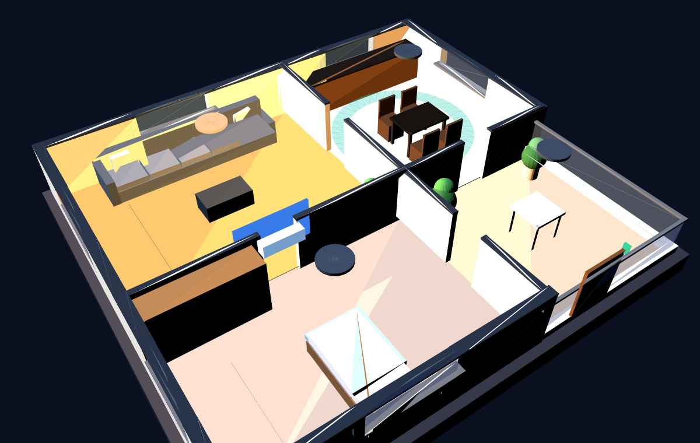

# Sweet Home



<sub>The demo house from the test page, drawn with three.js' SVG renderer. In Home Assistant the card adds shadows, textures and glowing lights.</sub>

Your home as an interactive **3D model** in Home Assistant. Tap a room to see and switch what is in it. Tabs cover
security, climate, energy, water, media and your home lab.

- **3D house**: walls, windows, doors that swing open with their contact sensors, furniture, glowing lights (ceiling
  lights, spots, LED strips, TV backlight), AC airflow, motion pulses and lock badges. Three views: Lights, Climate and Presence.
- **Works with no setup**: without any configuration it builds a simple house from your Home Assistant areas. Draw
  your real floor plan in the card editor, or load your own `.glb` model.
- **Panels**, each shown only when Home Assistant has something for it:
  - **Security**: alarm with a PIN keypad, locks, doors, live cameras
  - **Climate**: ACs, temperatures
  - **Energy**: live power flow and a chart of today, plus history by day, week, month and year from your Energy settings
  - **Water & Irrigation**: tank trend, pumps, valves, schedule
  - **Media**: TV and speakers, plus a Jellyfin / Sonarr / Radarr / qBittorrent media server card
  - **Home Lab**: Proxmox VE node and guests
  - **Needs Attention**: unavailable devices, low batteries, weak Wi-Fi, repairs, updates
- **Made for phones**:
  - Swipe between tabs. Haptics. Long press opens more-info; double tap opens the second entity.
  - Popups don't scroll the page behind them. Skeleton loaders while data arrives.
  - The 3D view sleeps when nothing moves, to save battery.

## Install

### Marketplace (recommended)

Home Assistant's **Marketplace** (formerly HACS):

1. **Marketplace** → ⋮ → **Custom repositories**. Add this repository's URL with the type **Dashboard**.
2. Search the Marketplace for **Sweet Home** and download it.
3. Reload the browser.

The Marketplace adds the dashboard resource for you. If it doesn't, add `/local/community/sweet-home/sweet-home-card.js`
as a **JavaScript module** under Settings → Dashboards → ⋮ → Resources.

### Manual

Download `sweet-home-card.js` from the latest release and put it in `/config/www/`. Then add
`/local/sweet-home-card.js` as a JavaScript module resource.

## Add the card

The card is built to fill the screen. Create a view with the **Panel** layout and add the card:

```yaml
type: custom:sweet-home-card
```

You can also pick **Sweet Home** in the card picker. The visual editor has three steps:

1. **Rooms**: link rooms to areas, then draw each room by dragging on a grid. Draw more than one rectangle for an L-shaped room.
2. **Panels**: turn panels on or off and pick their entities.
3. **Look**: title, weather, start tab, wall height, automatic furniture, or a 3D file.

Everything the editor doesn't cover can be added in YAML, and the editor keeps it.

## Configuration

| Option | Description |
|---|---|
| `title` | Name in the 3D view header (default `My Home`) |
| `weather` | Weather entity for the header chip and weather sheet (default: the first one) |
| `persons` | Person entities shown as avatars. Long press opens the phone panel when the person has a Companion app tracker. |
| `start_tab` | `home` / `security` / `climate` / `energy` / `water` / `media` / `system` |
| `modes` | Switches or input booleans shown as mode buttons (`entity`, `name`, `icon`) |
| `devices` | Phones and tablets with battery and charging state (default: every Companion app battery sensor) |
| `house` | The 3D model, described below |
| `panels` | The panels, described below. `panels.<name>: false` hides one. |

### `house`

| Option | Description |
|---|---|
| `rooms` | List of rooms, described below. Leave it out to build the house from your areas. |
| `areas` | With automatic rooms: only these area ids |
| `auto_furniture` | Add furniture to every room based on its name |
| `wall_height` | In metres (default 1.35, a cut-away dollhouse height) |
| `walls` | Your own wall segments `[x1, z1, x2, z2, type]`, where type is `w` (wall), `win` (window) or `rail` (glass railing). By default, walls are drawn around the rooms. |
| `openings` | Gaps in the automatic walls `[x1, z1, x2, z2]` |
| `windows` | Window segments on the automatic outer walls |
| `doors` | Animated doors: `entity` (contact sensor), `from: [x, z]`, `to: [x, z]`, `side` (1 / −1: which way it swings), `main` |
| `door_info` | Names and timeout sensors for doors in the room popup (`entity`, `name`, `timeout`) |
| `lock_badges` | Small 3D badges for locks: `lock`, `x`, `z`, `y`, `axis` |
| `furniture` | Furniture anywhere in the house (the same pieces as in rooms) |
| `type: gltf`, `url`, `scale`, `rotation`, `offset`, `mesh_rooms` | Use your own 3D file instead of the drawn walls. See [examples/gltf.yaml](examples/gltf.yaml). |

Coordinates are in metres. **x** runs to the east (right) and **z** to the south (down the screen). The plan is
shifted so that it starts at 0.

### Rooms

```yaml
- area: bedroom               # devices in this area are found automatically
  name: Main Bedroom          # default: the area name
  rects: [[0, 5, 5, 9]]       # one or more [x1, z1, x2, z2]
  icon: mdi:bed
  floor: carpet               # wood, tile, marble, carpet, stone, grass
  outdoor: false
  furniture: [...]            # or `false` for none
  # overrides for what was discovered:
  lights: [light.bedroom]
  temperature: sensor.bedroom_temperature
  humidity: sensor.bedroom_humidity
  motion: [binary_sensor.bedroom_motion]
  climate: climate.bedroom_ac
  media: media_player.bedroom_tv
  plugs: [switch.bedside_plug]
  light_fx: {light.bedroom_led: strip}   # center, spots, strip or tv
  light_names: {light.bedroom_led: LED Strip}
  color_lights: [light.bedroom_led]      # show colour swatches
  simple_lights: [light.tv_backlight]    # on/off only
  strip_sides: nes                       # walls that have the LED strip
  ac: {x: 0.2, z: 6, dx: 1, dz: 0}       # where the AC unit hangs and which way it blows
  anchor: [2.5, 7]                       # label position
```

### Furniture

Each piece has a `type` plus a position. `x`, `z` give the centre; `from` and `to` give the corners. Colours are `#hex`.

| type | Options |
|---|---|
| `box` | `x z w d h y color roughness metalness opacity emissive` |
| `block` | `from to h y color` |
| `rug` | `x z w d color` |
| `table` | `x z w d h top leg` |
| `chair` | `x z face (n/s/e/w) color seat` |
| `sofa` | `from to back (n/s/e/w) color cushion pillow arms (both/start/end/none)` |
| `bed` | `x z width length head (n/s/e/w) frame duvet headboard pillow house_headboard` |
| `plant` | `x z size` |
| `cylinder`, `ball` | `x z radius h y color` |
| `tv` | `x z w h y facing entity`: the screen flickers while the player plays |
| `charger` | `x z y plug power`: a phone that glows while charging |
| `stairs` | `from to axis (x/z) mode (up/down/split) steps motion` |

### `panels`

See [examples/panels.yaml](examples/panels.yaml) for every panel.

- **security**: `alarm`, `locks`, `doors`, `cameras` (`entity`, `person`, `car`, `motion`, `face`, `plate`), `gate` (`relay`, `sensor`)
- **climate**: `entities`
- **energy**: live power and history come from **Settings → Dashboards → Energy**. Options:
  - `grid_power`, `solar_power`: your own power sensors
  - `month_sensor`, `year_sensor`, `stored_sensor`: template sensors for the totals
  - `extra`: more rows for the energy card
  - `exclude`: meters to leave out
  - `devices`: names and colours for the history chart
- **water**: `tank`, `quality`, `temperature`, `pumps` (`entity`, `power`, `timer`)
- **irrigation**: `zones` (`entity`, `name`, `duration`), `interval`, `weekday`, `tomorrow`, `next`, `notification`
- **car**: `charging`, `power`, `time`, `energy_per_charge`, `cost_per_charge`, `energy_month`, `cost_month`, `energy_year`, `cost_year`, `status`
- **media**:
  - `player`, `speakers`
  - optional screen-time limits: `watch_timer`, `watch_limit`, `limit_select`, `block_switch`, `unblock_switch`
- **media_server**: found from the Jellyfin, Sonarr, Radarr and qBittorrent integrations. `jellyfin_tv` can start the
  Jellyfin app on an Android TV before playing.
- **homelab**: found from the Proxmox VE custom integration. Options: `pinned` guests, `temperature`.
- **tv_light**: `light`, `selects`
- **attention**:
  - `battery_threshold`, `wifi_threshold`, `tunnels`
  - `unavailable_domains`, `unavailable_integrations`
  - `exclude_devices`, `exclude_entities`, `battery_exclude`

## Gestures

| Gesture | Action |
|---|---|
| Tap | The button's action: toggle, open, select |
| Double tap | More-info of the second entity, for example the power sensor of a switch |
| Long press | More-info of the button's own entity |
| Swipe sideways | Next or previous tab |
| 3D view | Drag to rotate, two fingers or right-drag to pan, pinch or wheel to zoom, tap a room to open it |

Locks, gate relays and other risky switches need a second tap to confirm.

## Development

```bash
npm install
npm run build      # → dist/sweet-home-card.js (three.js is bundled)
npm run check      # build + module evaluation test
python3 -m http.server 8799   # then open http://127.0.0.1:8799/test/?config=demo
```

The test page uses a made-up home and records service calls instead of sending them.

## License

MIT
