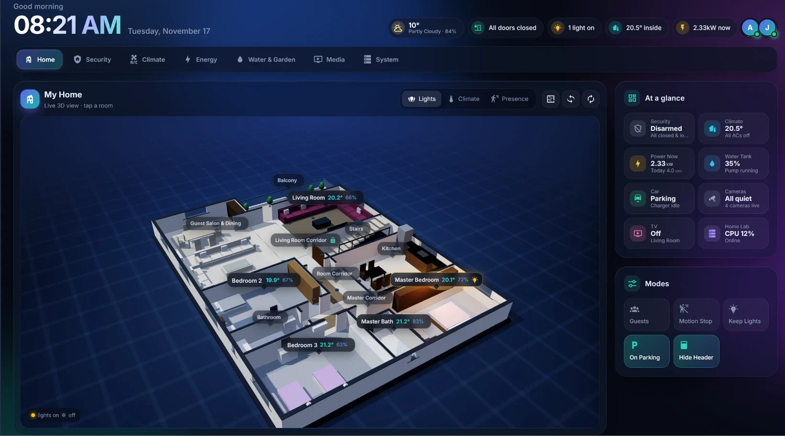
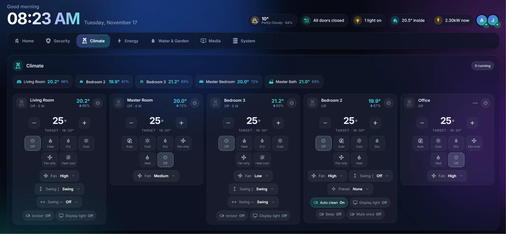

# Sweet Home

[](https://my.home-assistant.io/redirect/hacs_repository/?owner=mousawm&repository=sweet-home&category=plugin)



Your home as an interactive **3D model** in Home Assistant. Tap a room to see and switch what is in it. Tabs cover
security, climate, energy, water, media and your home lab.

- **3D house**: walls, windows, doors that swing open with their contact sensors, furniture, glowing lights (ceiling
  lights, spots, LED strips, TV backlight), AC airflow, motion pulses and lock badges. Three views: Lights, Climate and Presence.
- **Works with no setup**: without any configuration it builds a simple house from your Home Assistant areas. Draw
  your real floor plan in the card editor, or load your own `.glb` model.
- **Panels**, each shown only when Home Assistant has something for it:
  - **Security**: alarm with a PIN keypad, locks, doors, live cameras
  - **Climate**: ACs, temperatures
  - **Energy**: live power flow and a chart of today, plus history by day, week, month and year from your Energy settings
  - **Water & Irrigation**: tank trend, pumps, valves, schedule
  - **Media**: TV and speakers, plus a Jellyfin / Sonarr / Radarr / qBittorrent media server card
  - **Home Lab**: Proxmox VE node and guests
  - **Needs Attention**: unavailable devices, low batteries, weak Wi-Fi, repairs, updates
- **Made for phones**:
  - Swipe between tabs. Haptics. Long press opens more-info; double tap opens the second entity.
  - Popups don't scroll the page behind them. Skeleton loaders while data arrives.
  - The 3D view sleeps when nothing moves, to save battery.

## Screenshots

| Security | Climate |
|---|---|
|  |  |
| **Energy** | **Water & Garden** |
|  |  |

## Install

### Marketplace (recommended)

Home Assistant's **Marketplace** (formerly HACS):

[](https://my.home-assistant.io/redirect/hacs_repository/?owner=mousawm&repository=sweet-home&category=plugin)

1. Click the button above. It opens Sweet Home in your Marketplace and offers to add the repository. Or add it by hand: **Marketplace** → ⋮ → **Custom repositories**, this repository's URL, type **Dashboard**.
2. Search the Marketplace for **Sweet Home** and download it.
3. Reload the browser, then [add the dashboard](#from-add-dashboard-recommended).

The Marketplace adds the dashboard resource for you. If it doesn't, add `/local/community/sweet-home/sweet-home-card.js`
as a **JavaScript module** under Settings → Dashboards → ⋮ → Resources.

### Manual

Download `sweet-home-card.js` from the latest release and put it in `/config/www/`. Then add
`/local/sweet-home-card.js` as a JavaScript module resource.

## Add it to Home Assistant

### From "Add dashboard" (recommended)

Once Sweet Home is installed, it is listed with the other community dashboards:

1. Go to **Settings → Dashboards → Add dashboard**.
2. Under **Community dashboards**, pick **Sweet Home**. Its description reads *"Your home as an interactive 3D model, with
   tabs for security, climate, energy, media and more. Built from your areas."*
3. Give the dashboard a name and an icon, then open it from the sidebar.

The dashboard builds itself from your Home Assistant **areas**. Each area becomes a room with its lights, sensors, doors
and climate devices. The tabs show what Home Assistant has for them: alarm, locks, cameras, energy, media and so on.
It shows the whole house full screen.

Not listed? Reload the browser after installing (on the phone app: ⋮ → Reload resources), and check that you have
version 0.1.1 or newer.

### Edit it

The dashboard is generated for you until you take control of it:

1. Open the dashboard and click the **pencil** (or **⋮ → Edit dashboard**) at the top right.
2. Choose **Take control**. The dashboard becomes a normal one with a single Sweet Home card.
3. Click **Edit** at the left end of the bar under the card. The ⋮ at its right end only has move, copy and delete.
4. The Sweet Home editor opens with three steps:
   1. **Rooms**: a floor plan with four modes. A setup guide walks you through them the first time.
      - **Shape**: add rooms (or all your areas at once), link them to areas, and draw them by dragging on a grid. Drag
        a rectangle to move it and its corner dots to resize it. Draw more than one rectangle for an L-shaped room.
        Duplicate or delete rooms.
      - **Entities**: what each room shows in its popup. Devices in the room's area are found on their own. Remove
        what you don't want, add other devices from the area, or add any entity. Set how each light is drawn (ceiling
        light, spots, LED strip, TV backlight), with or without colours. A list shows devices that are in no room yet.
      - **Furniture**: pick a piece, then tap the plan to place it. Drag to move, use the corner dot to resize, and
        **Turn** to rotate. Link a piece to one or more entities, such as a lamp to its light or a bed to the bedside
        lights, so it can be tapped in the 3D view. **Suggest furniture** fills a room from its name.
      - **Doors & windows**: rooms are closed by walls until you add a way through. Drag along a wall to add a door
        (pick its contact sensor to make it swing open in 3D), a window or an open passage. Tap to add a lock badge.
        Drag any of them to move it.

      **Floors**: tabs above the plan switch floors, and **Add floor** adds one. Other floors show as dashed outlines
      so you can line them up. Areas on a Home Assistant floor are added to that floor. In Entities mode, edit a
      name to rename the entity in Home Assistant itself.

      **Undo / Redo** (Ctrl+Z / Ctrl+Shift+Z) cover every change. *Things to check* lists entities that weren't found,
      rooms without a shape and devices that are in another room's area.
   2. **Panels**: turn panels on or off and pick their entities.
   3. **Look**: title, weather, start tab, wall height, automatic furniture, the first-use tip, or a 3D file.
5. Click **Save**, then **Done**.

Everything the editor doesn't cover can be added in YAML (**Show code editor**, or the dashboard's **⋮ → Raw
configuration editor**), and the editor keeps it. See [Configuration](#configuration) below.

### As a card on any dashboard

You can also add the card yourself: **Edit dashboard → Add card → Sweet Home**, or in YAML:

```yaml
type: custom:sweet-home-card
```

It is built to fill the screen, so put it in a view with the **Panel** layout (view settings → View type → Panel).

## Configuration

| Option | Description |
|---|---|
| `title` | Name in the 3D view header (default `My Home`) |
| `weather` | Weather entity for the header chip and weather sheet (default: the first one) |
| `persons` | Person entities shown as avatars. Long press opens the phone panel when the person has a Companion app tracker. |
| `start_tab` | `home` / `security` / `climate` / `energy` / `water` / `media` / `system` |
| `modes` | Switches or input booleans shown as mode buttons (`entity`, `name`, `icon`) |
| `devices` | Phones and tablets with battery and charging state (default: every Companion app battery sensor) |
| `hint` | `false` hides the "tap a room" tip shown on first use |
| `language` | Language of the card, such as `ar` (default: your Home Assistant language). Arabic is translated and laid out right to left; other languages fall back to English. |
| `house` | The 3D model, described below |
| `panels` | The panels, described below. `panels.<name>: false` hides one. |

### `house`

| Option | Description |
|---|---|
| `rooms` | List of rooms, described below. Leave it out to build the house from your areas (one floor per Home Assistant floor). |
| `levels` | Floor names: `[{level: 0, name: Downstairs}, {level: 1, name: Upstairs}]` (default: the Home Assistant floor names) |
| `doorways` | `auto` puts a doorway in every wall between two rooms. By default walls stay closed until you add `doors` or `openings`. (The house built from your areas always gets doorways.) |
| `areas` | With automatic rooms: only these area ids |
| `auto_furniture` | Add furniture to every room based on its name |
| `wall_height` | In metres (default 1.35, a cut-away dollhouse height) |
| `walls` | Your own wall segments `[x1, z1, x2, z2, type]`, where type is `w` (wall), `win` (window) or `rail` (glass railing). By default, walls are drawn around the rooms. |
| `openings` | Gaps in the automatic walls `[x1, z1, x2, z2]`, plus the floor as a 5th item when it isn't the ground floor |
| `windows` | Window segments on the automatic outer walls (`[x1, z1, x2, z2, level]`) |
| `doors` | Doors: `from: [x, z]`, `to: [x, z]`, `entity` (contact sensor: the door swings open while it is open; without one the door stays shut), `side` (1 / −1: which way it swings), `main`, `level`. A door cuts its own gap in the wall. |
| `door_info` | Names and timeout sensors for doors in the room popup (`entity`, `name`, `timeout`) |
| `lock_badges` | Small 3D badges for locks: `lock`, `x`, `z`, `y`, `axis`, `level` |
| `furniture` | Furniture anywhere in the house (the same pieces as in rooms) |
| `type: gltf`, `url`, `scale`, `rotation`, `offset`, `mesh_rooms` | Use your own 3D file instead of the drawn walls. See [examples/gltf.yaml](examples/gltf.yaml). |

Coordinates are in metres. **x** runs to the east (right) and **z** to the south (down the screen). The plan is
shifted so that it starts at 0.

### Rooms

```yaml
- area: bedroom               # devices in this area are found automatically
  name: Main Bedroom          # default: the area name
  rects: [[0, 5, 5, 9]]       # one or more [x1, z1, x2, z2]
  icon: mdi:bed
  floor: carpet               # wood, tile, marble, carpet, stone, grass
  outdoor: false
  level: 1                    # the floor (default 0, the ground floor)
  stairs: true                # draw a flight of stairs (automatic for rooms named "Stairs")
  furniture: [...]            # or `false` for none
  # overrides for what was discovered:
  lights: [light.bedroom]
  temperature: sensor.bedroom_temperature
  humidity: sensor.bedroom_humidity
  motion: [binary_sensor.bedroom_motion]
  climate: climate.bedroom_ac
  media: media_player.bedroom_tv
  plugs: [switch.bedside_plug]
  entities: [cover.bedroom_blinds, script.good_night]   # anything else, under "Other"
                                         # (default: blinds, plain switches, valves… found in the area)
  light_fx: {light.bedroom_led: strip}   # center, spots, strip or tv
  light_names: {light.bedroom_led: LED Strip}
  color_lights: [light.bedroom_led]      # show colour swatches
  simple_lights: [light.tv_backlight]    # on/off only
  strip_sides: nes                       # walls that have the LED strip
  ac: {x: 0.2, z: 6, dx: 1, dz: 0}       # where the AC unit hangs and which way it blows
  anchor: [2.5, 7]                       # label position
```

### Furniture

Each piece has a `type` plus a position. `x`, `z` give the centre; `from` and `to` give the corners. Colours are `#hex`.

Any piece can be linked to entities with `entity` (or `entities` for several), plus an optional `name`. A linked
piece can be tapped in the 3D view: its room opens with the piece and its entities at the top. It also gets a small
badge, which shows the entity's icon while it is on or while its room is open. `badge: false` hides the badge.

```yaml
furniture:
  - { type: bed, x: 3, z: 7.8, head: s, entities: [light.bedside_left, light.bedside_right] }
  - { type: lamp, x: 1.6, z: 8.5, entity: light.reading_lamp }
  - { type: fan, x: 3, z: 6.8, entity: fan.bedroom }
  - { type: marker, name: Window sensor, x: 0.3, z: 6, entity: binary_sensor.bedroom_window }
  - { type: box, name: Coffee corner, x: 9.4, z: 1.4, w: 0.8, d: 0.6, h: 0.9, entity: switch.coffee_machine }
```

| type | Options |
|---|---|
| `box` | `x z w d h y color roughness metalness opacity emissive` |
| `block` | `from to h y color` |
| `rug` | `x z w d color` |
| `table` | `x z w d h top leg` |
| `chair` | `x z face (n/s/e/w) color seat` |
| `sofa` | `from to back (n/s/e/w) color cushion pillow arms (both/start/end/none)` |
| `bed` | `x z width length head (n/s/e/w) frame duvet headboard pillow house_headboard` |
| `plant` | `x z size` |
| `cylinder`, `ball` | `x z radius h y color` |
| `tv` | `x z w h y facing entity`: the screen flickers while the player plays |
| `charger` | `x z y plug power`: a phone that glows while charging |
| `stairs` | `from to axis (x/z) mode (up/down/split) steps motion` |
| `lamp` | `x z h size color shade entity`: the shade glows in the light's colour and brightness |
| `fan` | `x z y radius color blade entity`: a ceiling fan whose blades turn at the fan's speed |
| `marker` | `x z y color entity`: a device with no furniture (a sensor, a plug): a dot that lights up while it is on |
| `blinds` | `from to y h color shade entity`: a blind along a window that rolls down with the cover's position |
| `vacuum` | `x z color entity`: a dock and a robot that drives around the room while it cleans and goes back after |
| all types | `entity` / `entities`, `name`, `badge` |

**Move furniture in 3D**: admins get a **move** button on the 3D view. Turn it on and drag pieces across the floor.
While the card editor is open, each move goes through it (with undo). Otherwise it is saved straight into the
dashboard. Pieces from the automatic set can be moved once their room has its own furniture (card editor → Furniture).

### `panels`

See [examples/panels.yaml](examples/panels.yaml) for every panel.

- **security**: `alarm`, `locks`, `doors`, `cameras` (`entity`, `person`, `car`, `motion`, `face`, `plate`), `gate` (`relay`, `sensor`)
- **climate**: `entities`
- **energy**: live power and history come from **Settings → Dashboards → Energy**. Options:
  - `grid_power`, `solar_power`: your own power sensors
  - `month_sensor`, `year_sensor`, `stored_sensor`: template sensors for the totals
  - `extra`: more rows for the energy card
  - `exclude`: meters to leave out
  - `devices`: names and colours for the history chart
- **water**: `tank`, `quality`, `temperature`, `pumps` (`entity`, `power`, `timer`)
- **irrigation**: `zones` (`entity`, `name`, `duration`), `interval`, `weekday`, `tomorrow`, `next`, `notification`
- **car**: `charging`, `power`, `time`, `energy_per_charge`, `cost_per_charge`, `energy_month`, `cost_month`, `energy_year`, `cost_year`, `status`
- **media**:
  - `player`, `speakers`
  - optional screen-time limits: `watch_timer`, `watch_limit`, `limit_select`, `block_switch`, `unblock_switch`
- **media_server**: found from the Jellyfin, Sonarr, Radarr and qBittorrent integrations. `jellyfin_tv` can start the
  Jellyfin app on an Android TV before playing.
- **homelab**: found from the Proxmox VE custom integration. Options: `pinned` guests, `temperature`.
- **tv_light**: `light`, `selects`
- **attention**:
  - `battery_threshold`, `wifi_threshold`, `tunnels`
  - `unavailable_domains`, `unavailable_integrations`
  - `exclude_devices`, `exclude_entities`, `battery_exclude`

## Gestures

| Gesture | Action |
|---|---|
| Tap | The button's action: toggle, open, select |
| Double tap | More-info of the second entity, for example the power sensor of a switch |
| Long press | More-info of the button's own entity |
| Swipe sideways | Next or previous tab |
| 3D view | Drag to rotate, two fingers or right-drag to pan, pinch or wheel to zoom, tap a room to open it |
| 3D furniture | Tap a linked piece (or its badge) to open its room with the piece at the top |
| Floors | The floor buttons on the 3D view switch floors; opening a room on another floor switches to it |
| Rename | Admins: the pencil in a room's popup renames its devices in Home Assistant |

Locks, gate relays and other risky switches need a second tap to confirm.

## Development

```bash
npm install
npm run build      # → dist/sweet-home-card.js (three.js is bundled)
npm run check      # build + module evaluation test
npm test           # check + model tests + browser tests (npx playwright install chromium once)
python3 -m http.server 8799   # then open http://127.0.0.1:8799/test/?config=demo
```

The test page uses a made-up home and records service calls instead of sending them. Add `&editor=1` to open the
card editor next to the card, with a simple stand-in for Home Assistant's form fields.

## License

MIT
